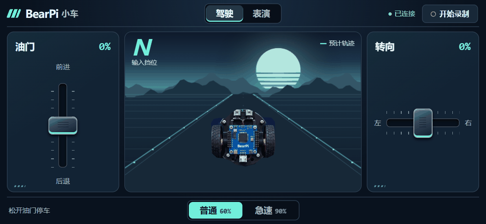

# BearPi-Car

在手机上连接小车热点，左手控制油门，右手控制转向。BearPi-HM Nano 在车上提供网页、接收指令，并通过双路电机驱动板控制左右轮。电脑也可以通过 USB 调试和驾驶。

## 从这里开始

| 你要做的事 | 入口 |
| --- | --- |
| 组装底盘、接驱动板、核对供电 | [实验器材与接线](docs/hardware.md) |
| 了解项目分期、驾驶方式和验收情况 | [需求与设计](docs/design.md) |
| 接手离线语音控制 | [语音遥控交接](docs/voice-handoff.md) |
| 调整车轮输出、超时停车或无线控制协议 | [电机控制](firmware/motor_test.c) · [热点与 HTTP 服务](firmware/wireless.c) |
| 修改手机驾驶台 | [网页源码](web/) · [板端通信适配](web/board_transport.js) |
| 使用电脑控制台或查看早期手机中转实现 | [桌面端](desktop/) · [早期 USB 网桥](legacy/bridge.py) |
| 核对实际烧录版本和启动记录 | [v12 验证材料](verification/) |

## 使用已烧录的小车

1. 先断开电机电池，用 USB 给主板供电。手机加入 **BearPi-Car**，向组员获取当前小车的热点密码。
2. 在浏览器打开 **http://192.168.4.1/**。横屏进入驾驶页，保持电机电池断开可以体验界面。
3. 首次带电测试先架空车轮，接通电机电池，在普通模式轻推油门，确认左右轮方向与松手停车。落地后再试弧线和表演。无线行驶时主板仍需要稳定的 USB 供电。
4. 电脑控制台使用带 Tk 的 Windows Python 3、USB 数据线与 pySerial。在仓库根目录运行以下命令，选择实际端口后连接。烧录前释放串口。

~~~powershell
python -m pip install -r requirements.txt
python desktop/control_panel.py
~~~

## 从源码编译

使用能编译 BearPi-HM Nano 的 Ubuntu OpenHarmony SDK 环境。项目复用 SDK 的 RISC-V GCC、GN 和 Ninja；SDK 工程目录作为参数传入。将完整仓库放入虚拟机，在仓库根目录执行：

~~~bash
cp firmware/wifi_local.example.h firmware/wifi_local.h
# 编辑 wifi_local.h，将示例值替换成你们自己的 8 至 63 位 ASCII 热点口令
python3 tools/embed_web.py
python3 firmware/build_car.py /实际路径/bearpi-hm_nano
~~~

每次修改 web 目录后重新执行后两步。嵌入脚本为板端替换通信实现。构建脚本在 SDK 中暂时选择小车示例，退出时恢复原来的 sample/BUILD.gn。输出位于 SDK 的 out/car_stage1，包括 allinone.bin、manifest.json 和 build.log。

用 HiBurn 选择生成的 Hi3861_wifiiot_app_allinone.bin 和开发板串口，进入 Auto burn 等待后短按 RESET。两个分区写入成功后关闭 HiBurn，打开 115200 波特率串口，再短按 RESET。上电停车后查询 AT+CAR=?，新版应返回 car-stage1-v12，随后可按热点地址访问。板上原固件含在用热点口令，仓库提供可重新构建的源码。使用不同口令构建后，固件哈希会随之改变。

## 离线回归与版本证据

在根目录运行 `python desktop/test_controls.py` 可检查键盘、失焦停车和路线状态。手机测试使用 Node.js、Playwright 与 Chromium，运行 `npm install --no-save --package-lock=false playwright`、`npx playwright install chromium`，再运行 `node verification/mobile.cjs`。使用已安装的 Edge 时，可将 BROWSER_EXECUTABLE 环境变量指向其可执行文件。测试拦截网页的网络请求，可在不接小车时运行。

[原机启动摘录](verification/boot-v12.txt)记录固件版本、停车状态和热点。构建清单中的 hardware_test 是打包当时的标记，启动摘录来自随后实际烧录和复位。早期 USB 网桥只接受 v6 版本回报；当前实车请使用热点直连，或使用桌面串口控制台。
